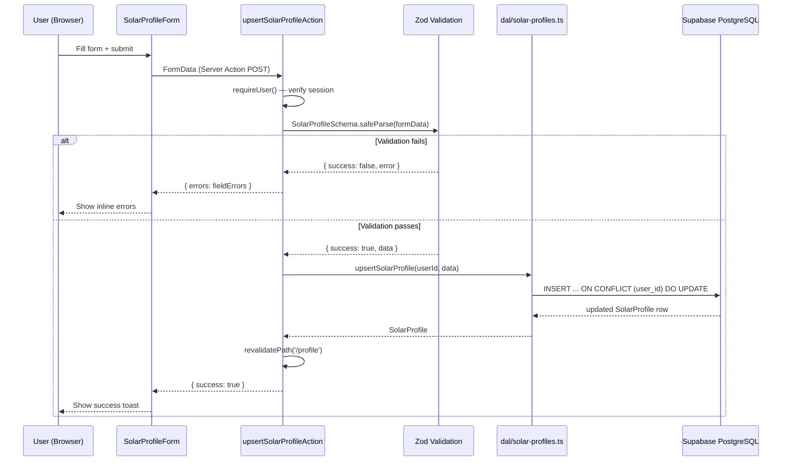
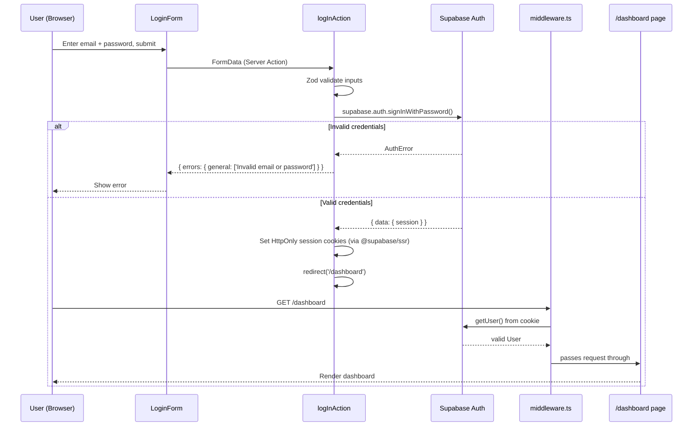

# Design Document: Solar Intelligence Platform

## Overview

The Solar Dashboard is a minimal Next.js 16 / TypeScript static application that simulates solar panel monitoring and ROI calculation for a fixed 10-panel Monocrystalline PERC system in Hyderabad. Every data value today is hard-coded or randomly generated in `lib/solarData.ts` — there is no database, no user identity, no real-time data, and no AI of any kind.

This document describes the evolution of that prototype into the **Solar Intelligence Platform**: a full-stack, AI-powered product focused on Telangana / Hyderabad that allows real users to create accounts, model their own solar installations, ask questions to a grounded AI Solar Advisor, simulate configurations, and receive accurate, source-cited financial and technical estimates — completely free of hallucinated values.

The design covers the complete target architecture, identifies problems in the current codebase, defines Phase 1 (Architecture & Foundation) and Phase 2 (Authentication + Solar Profile) in concrete, implementable detail, and lays the design-level groundwork for the RAG pipeline and AI Advisor that will be built in later phases.

---

## Part 1 — Current Architecture Analysis

### What the Existing Project Does

| Concern | Current state |
|---|---|
| Framework | Next.js 16 App Router, TypeScript, Tailwind v4, ShadCN UI |
| Pages | `/` (home), `/dashboard` (live monitor), `/calculator` (ROI), `/history` (7-day table) |
| Data | 100% in-memory, deterministic + `Math.random()` in `lib/solarData.ts` |
| API routes | `api/dashboard/route.ts`, `api/history/route.ts` — both call the same in-memory generators |
| Auth | None |
| Database | None |
| AI | None |
| State | All local React state or direct Server Component calls |
| Key libraries | recharts, framer-motion, @react-three/fiber, shadcn, lucide-react |

The existing UI components worth preserving:
- `components/ui/*` — full ShadCN set
- `components/AnimatedCard.tsx` + `AnimatedContainer` — Framer Motion wrappers
- `components/PageWrapper.tsx` — fade-in page wrapper
- `components/OutputChart.tsx` — hourly area chart
- `components/BreakevenChart.tsx` — multi-panel breakeven line chart
- `components/HomeComponents.tsx` — educational home page content
- `lib/calculations.ts` — `calculateROI`, `generateBreakevenCurves` — these are pure functions, reusable

### Current Architectural Problems

**1. Static / fake data everywhere**
`lib/solarData.ts` contains hard-coded hourly output arrays, fixed tariff values (₹8/kWh), and `Math.random()` noise. The dashboard claims to show "live" output but nothing is real. The ₹3.5/unit net metering rate and ₹6.30/kWh tariff are embedded in component strings rather than a single source of truth.

**2. Misplaced API routes**
`api/dashboard/route.ts` and `api/history/route.ts` live at the project root (`/api/`) not inside `/app/api/`. In Next.js App Router, all route handlers must be `app/**/route.ts`. These routes currently work only because `tsconfig.json` maps `@/*` to `./` (root), but they do not follow App Router conventions and will conflict with any future `app/api/` hierarchy.

**3. Business logic inside data layer**
`lib/solarData.ts` mixes data type definitions, mock data generation, and domain-specific business logic (grid status classification, net metering threshold). Types and logic should be separated.

**4. `'use client'` on the dashboard page itself**
`app/dashboard/page.tsx` imports `motion` from `framer-motion` at the page level, which forces the entire page into the client bundle. The animated wrappers should be extracted to client-only leaf components so the page itself remains a Server Component and can do async data fetching directly.

**5. No server-side authorization**
No concept of "is this user allowed to see this data?" exists. As a multi-user platform this must be addressed before any real data is stored.

**6. No environment variable discipline**
No `.env.example`, no `NEXT_PUBLIC_` / non-public distinction. Future secrets (Supabase service role key, LLM API key) would have nowhere safe to live.

**7. No separation of concerns for calculations**
`lib/calculations.ts` performs pure financial math (good) but the breakeven curve generator is coupled to the `panelTypes` static array from `solarData.ts`. As we add database-backed system configurations this coupling breaks.

**8. Unused heavy dependencies**
`@react-three/fiber`, `@react-three/drei`, and `three` appear in `package.json` but none of the existing pages use Three.js rendering. These add ~500 KB to the bundle for no current benefit.

**9. Hardcoded geography**
Hyderabad-specific values (tariff, irradiance, city name) are scattered across component strings. The platform is intended to be extensible to other cities/states — these values must be data-driven.

---

## Part 2 — Target Architecture

### High-Level System Architecture

```
┌────────────────────────────────────────────────────────────────────────────┐
│                         BROWSER (Client)                                   │
│                                                                            │
│  Next.js App Router                                                        │
│  ┌──────────────┐  ┌──────────────┐  ┌──────────────┐  ┌──────────────┐  │
│  │  /dashboard  │  │  /profile    │  │  /advisor    │  │  /simulator  │  │
│  │  (Phase 1)   │  │  (Phase 2)   │  │  (Phase 3+)  │  │  (Phase 3+)  │  │
│  └──────────────┘  └──────────────┘  └──────────────┘  └──────────────┘  │
│         │                  │                  │                  │         │
│         └──────────────────┴──────────────────┴──────────────────┘         │
│                             │ Server Components / Server Actions            │
└─────────────────────────────┼──────────────────────────────────────────────┘
                              │
                    ┌─────────▼──────────┐
                    │  Next.js Server    │
                    │  (Node.js runtime) │
                    │                   │
                    │  app/             │
                    │  ├─ actions/      │ ← Server Actions ('use server')
                    │  ├─ api/          │ ← Route Handlers
                    │  └─ ...pages      │
                    │                   │
                    │  lib/             │
                    │  ├─ db/           │ ← Supabase client (server-only)
                    │  ├─ auth/         │ ← Auth utilities (server-only)
                    │  ├─ dal/          │ ← Data Access Layer (server-only)
                    │  ├─ calculations/ │ ← Pure solar/financial math
                    │  └─ ai/           │ ← AI/RAG services (Phase 3+)
                    └─────────┬──────────┘
                              │
              ┌───────────────┼─────────────────┐
              │               │                 │
    ┌─────────▼──────┐ ┌──────▼───────┐ ┌──────▼────────────┐
    │  Supabase Auth  │ │  Supabase DB │ │  LLM API          │
    │                 │ │  PostgreSQL  │ │  (Phase 3+)       │
    │  - JWT tokens   │ │  + pgvector  │ │  Structured tools │
    │  - OAuth later  │ │              │ │                   │
    └─────────────────┘ │  Tables:     │ └───────────────────┘
                        │  users       │
                        │  solar_      │
                        │  profiles    │
                        │  documents   │ ← Phase 3+
                        │  doc_chunks  │ ← Phase 3+
                        │  converstns  │ ← Phase 3+
                        └──────────────┘
```

### Component Breakdown and Responsibilities

#### Frontend Layer (Next.js App Router)

| Component group | Responsibility |
|---|---|
| `app/(public)/*` | Unauthenticated pages: home, login, signup |
| `app/(app)/*` | Authenticated pages: dashboard, profile, advisor, simulator |
| `app/(app)/layout.tsx` | Shared authenticated layout with sidebar navigation |
| `app/api/*` | Route handlers for REST endpoints (dashboard data, future webhook) |
| `app/actions/*` | Server Actions for mutations: auth, profile CRUD |
| `components/ui/*` | ShadCN primitives — unchanged |
| `components/charts/*` | Chart components (OutputChart, BreakevenChart) — moved here |
| `components/solar/*` | Solar-domain UI: ProfileForm, SimulatorPanel, AdvisorChat |
| `components/layout/*` | Navbar, Sidebar, PageWrapper |

#### Service Layer (`lib/`)

| Module | Responsibility | Runtime |
|---|---|---|
| `lib/db/client.ts` | SSR Supabase server client (anon key + cookies, RLS enforced) — used by all user-facing DAL functions | Server only |
| `lib/db/admin-client.ts` | Admin Supabase client (service-role key, bypasses RLS) — Phase 3+ privileged ops only, never imported by user-facing DAL | Server only (Phase 3+) |
| `lib/db/supabase-browser.ts` | Supabase client for browser (anon key only) | Client only |
| `lib/auth/session.ts` | Read/verify Supabase session from cookies | Server only |
| `lib/dal/users.ts` | DTO functions: `getUserById`, `getUserProfile` | Server only |
| `lib/dal/solar-profiles.ts` | DTO functions: `getSolarProfile`, `upsertSolarProfile` | Server only |
| `lib/calculations/solar.ts` | Pure solar math: generation, savings, payback | Both (pure TS) |
| `lib/calculations/financial.ts` | ROI, NPV, subsidy calculations | Both (pure TS) |
| `lib/ai/rag.ts` | Document retrieval, embedding search | Server only (Phase 3+) |
| `lib/ai/advisor.ts` | Agent orchestration, tool dispatch | Server only (Phase 3+) |
| `lib/ai/tools/*` | Individual tool implementations | Server only (Phase 3+) |

#### Data Layer (Supabase PostgreSQL)

Separate `users` and `solar_profiles` tables (Phase 1 + 2). Future tables added per-phase.

---

## Part 3 — Security Architecture

### Principles

1. **No secrets in the browser.** Supabase service role key and all LLM API keys are `process.env.*` (no `NEXT_PUBLIC_` prefix). Only `NEXT_PUBLIC_SUPABASE_URL` and `NEXT_PUBLIC_SUPABASE_ANON_KEY` are exposed to the client — both are safe by design (they are restricted by Row Level Security).

2. **Server-side session verification on every protected request.** Every Server Component page in `(app)/` calls `lib/auth/session.ts` to verify the Supabase JWT from cookies before rendering. Every Server Action re-verifies auth internally — never trusting page-level checks.

3. **Row Level Security (RLS) on all user data tables.** Even if a bug leaks the anon key, Supabase RLS policies ensure users can only read/write their own rows.

4. **Data Access Layer pattern.** All Supabase queries go through `lib/dal/` which is marked `import 'server-only'`. Components never query the database directly.

5. **Input validation on the server.** All Server Action inputs validated with Zod before touching the database.

6. **No client-side authorization gates.** Route protection via Next.js middleware (`middleware.ts`) that checks Supabase session cookies and redirects unauthenticated users to `/login`.

### Authentication Flow

```
User visits /dashboard (authenticated route)
      │
      ▼
middleware.ts intercepts request
      │
      ├─ reads sb-access-token cookie
      ├─ calls supabase.auth.getUser() with service role
      │
      ├─ [invalid/missing] ──► redirect to /login
      │
      └─ [valid] ──────────── passes request to page
                                    │
                                    ▼
                           app/(app)/dashboard/page.tsx
                           Server Component
                                    │
                                    ▼
                           lib/dal/users.ts
                           getCurrentUser()
                                    │
                                    ▼
                           renders page with user data
```

### Supabase Session Strategy

Use Supabase's SSR helpers (`@supabase/ssr`) which manage `sb-access-token` and `sb-refresh-token` as `HttpOnly` cookies. The Next.js middleware refreshes tokens on expiry. This is the recommended pattern for Next.js App Router + Supabase.

---

## Part 4 — Phase Plan

| Phase | Name | Focus |
|---|---|---|
| **1** | Architecture & Foundation | Clean project structure, documentation, folder skeleton, remove fake data antipatterns, fix route handler locations |
| **2** | Authentication + Solar Profile | Supabase Auth, users table, solar_profiles table, RLS, sign-up/login/logout, profile CRUD |
| **3** | RAG Foundation + Document Ingestion | pgvector extension, documents + document_chunks tables, ingestion pipeline, embedding generation |
| **4** | AI Solar Advisor (MVP) | LLM integration, grounded QA, knowledge retrieval tool, citation display |
| **5** | Solar Simulator | Configurable system simulation, real calculation engine, comparison views |
| **6** | Agent Workflow | Full tool-calling agent: user profile tool, calculation tool, ML prediction tool |

This document covers Phase 1 and Phase 2 in full implementable detail. Phases 3–6 are design-level sketches.

---

## Part 5 — Target Folder/File Structure

The target structure after Phase 1 and Phase 2 are complete:

```
solar-dashboard/
├── .env.local                          ← local secrets (git-ignored)
├── .env.example                        ← template, committed to git
├── .kiro/                              ← Kiro spec directory
├── middleware.ts                       ← NEW: auth session refresh + route protection
├── next.config.ts                      ← minimal, unchanged
├── package.json                        ← add @supabase/ssr, @supabase/supabase-js, zod
├── tsconfig.json                       ← unchanged
│
├── app/
│   ├── layout.tsx                      ← root layout (no Navbar here in Phase 2)
│   ├── globals.css
│   ├── favicon.ico
│   │
│   ├── (public)/                       ← route group: no auth required
│   │   ├── layout.tsx                  ← NEW: public layout with top Navbar
│   │   ├── page.tsx                    ← existing home page (moved here)
│   │   ├── login/
│   │   │   └── page.tsx               ← NEW: login page
│   │   └── signup/
│   │       └── page.tsx               ← NEW: signup page
│   │
│   ├── (app)/                          ← route group: auth required
│   │   ├── layout.tsx                  ← NEW: app shell with sidebar nav
│   │   ├── dashboard/
│   │   │   └── page.tsx               ← existing dashboard (refactored: Server Component)
│   │   ├── calculator/
│   │   │   └── page.tsx               ← existing calculator (preserved)
│   │   ├── history/
│   │   │   └── page.tsx               ← existing history (preserved)
│   │   └── profile/
│   │       └── page.tsx               ← NEW: solar profile CRUD
│   │
│   └── api/                            ← moved from /api/ root
│       ├── dashboard/
│       │   └── route.ts               ← MOVED from /api/dashboard/
│       └── health/
│           └── route.ts               ← NEW: basic health check
│
├── actions/                            ← Server Actions
│   ├── auth.ts                        ← NEW: signUp, logIn, logOut
│   └── solar-profile.ts               ← NEW: upsertSolarProfile
│
├── components/
│   ├── ui/                             ← existing ShadCN primitives (unchanged)
│   ├── layout/
│   │   ├── Navbar.tsx                 ← existing (refactored: split public/app variants)
│   │   ├── AppSidebar.tsx             ← NEW: authenticated sidebar
│   │   └── PageWrapper.tsx            ← existing (preserved)
│   ├── charts/
│   │   ├── OutputChart.tsx            ← moved from /components/
│   │   └── BreakevenChart.tsx         ← moved from /components/
│   ├── solar/
│   │   └── SolarProfileForm.tsx       ← NEW: profile form (Client Component)
│   └── AnimatedCard.tsx               ← existing (preserved)
│
├── lib/
│   ├── db/
│   │   ├── client.ts                  ← NEW: Supabase server client (server-only)
│   │   └── supabase-browser.ts        ← NEW: Supabase browser client (anon key)
│   ├── auth/
│   │   └── session.ts                 ← NEW: getCurrentUser, requireUser
│   ├── dal/
│   │   ├── users.ts                   ← NEW: user DTO functions
│   │   └── solar-profiles.ts          ← NEW: solar profile DTO functions
│   ├── calculations/
│   │   ├── solar.ts                   ← REFACTORED from lib/calculations.ts
│   │   └── financial.ts               ← NEW: subsidy, NPV, long-term savings
│   ├── validations/
│   │   └── solar-profile.ts           ← NEW: Zod schema for profile form
│   ├── solarData.ts                   ← existing (kept for static demo data, clearly marked)
│   └── utils.ts                       ← existing (unchanged)
│
└── docs/                               ← NEW: architecture documentation
    ├── architecture.md                ← system overview
    ├── data-flow.md                   ← request data flow diagrams
    ├── auth-flow.md                   ← auth sequence diagrams
    ├── database.md                    ← schema + RLS documentation
    ├── ai-rag-architecture.md         ← RAG + agent design (future reference)
    └── folder-structure.md            ← this file's folder tree
```

---

## Part 6 — Database Schema (Phase 1 + Phase 2)

Only the tables needed for Phase 1 and Phase 2 are created now. Future tables (conversations, messages, documents, document_chunks, embeddings, solar_projects, predictions) are documented in `docs/database.md` but not created.

### Phase 1 — No schema changes
Phase 1 is structural. No database tables are created in Phase 1.

### Phase 2 — Schema

#### Table: `users`

Maps to Supabase Auth's `auth.users` table via foreign key. Stores display profile data separate from auth credentials.

```sql
CREATE TABLE public.users (
  id          UUID PRIMARY KEY REFERENCES auth.users(id) ON DELETE CASCADE,
  email       TEXT NOT NULL,
  full_name   TEXT,
  avatar_url  TEXT,
  created_at  TIMESTAMPTZ NOT NULL DEFAULT NOW(),
  updated_at  TIMESTAMPTZ NOT NULL DEFAULT NOW()
);

-- Auto-create a users row when auth.users gets a new entry
CREATE OR REPLACE FUNCTION public.handle_new_user()
RETURNS TRIGGER
LANGUAGE plpgsql
SECURITY DEFINER SET search_path = public
AS $$
BEGIN
  INSERT INTO public.users (id, email, full_name)
  VALUES (
    NEW.id,
    NEW.email,
    NEW.raw_user_meta_data ->> 'full_name'
  );
  RETURN NEW;
END;
$$;

CREATE TRIGGER on_auth_user_created
  AFTER INSERT ON auth.users
  FOR EACH ROW EXECUTE FUNCTION public.handle_new_user();

-- updated_at auto-update
CREATE OR REPLACE FUNCTION public.set_updated_at()
RETURNS TRIGGER LANGUAGE plpgsql AS $$
BEGIN
  NEW.updated_at = NOW();
  RETURN NEW;
END;
$$;

CREATE TRIGGER set_users_updated_at
  BEFORE UPDATE ON public.users
  FOR EACH ROW EXECUTE FUNCTION public.set_updated_at();
```

**RLS Policies:**
```sql
ALTER TABLE public.users ENABLE ROW LEVEL SECURITY;

-- Users can read only their own row
CREATE POLICY "users_select_own"
  ON public.users FOR SELECT
  USING (auth.uid() = id);

-- Users can update only their own row
CREATE POLICY "users_update_own"
  ON public.users FOR UPDATE
  USING (auth.uid() = id)
  WITH CHECK (auth.uid() = id);
```

---

#### Table: `solar_profiles`

One-to-one with `users`. Stores the user's self-reported solar installation context. A user creates or updates this through the Solar Profile page.

```sql
CREATE TABLE public.solar_profiles (
  id                    UUID PRIMARY KEY DEFAULT gen_random_uuid(),
  user_id               UUID NOT NULL UNIQUE REFERENCES public.users(id) ON DELETE CASCADE,

  -- Location
  city                  TEXT NOT NULL DEFAULT 'Hyderabad',
  state                 TEXT NOT NULL DEFAULT 'Telangana',
  district              TEXT,
  pincode               TEXT,

  -- Consumption & billing
  monthly_bill_inr      NUMERIC(10,2),         -- average monthly electricity bill in ₹
  monthly_units_kwh     NUMERIC(8,2),          -- average monthly consumption in kWh
  electricity_tariff_inr NUMERIC(6,4),         -- ₹/kWh (from TSSPDCL tariff slab)

  -- Roof details
  roof_area_sqft        NUMERIC(8,2),          -- usable roof area in sq ft
  roof_type             TEXT,                  -- 'flat-rcc', 'sloped-tile', 'metal-sheet', 'other'
  roof_orientation      TEXT,                  -- 'south', 'south-east', 'south-west', 'flat', 'other'
  shading_level         TEXT,                  -- 'none', 'partial', 'heavy'

  -- Desired system
  budget_inr            NUMERIC(12,2),         -- installation budget in ₹
  preferred_capacity_kw NUMERIC(6,2),          -- desired system size in kW
  battery_preference    TEXT NOT NULL DEFAULT 'no-battery',  -- 'no-battery', 'battery-backup', 'off-grid'

  -- Timestamps
  created_at            TIMESTAMPTZ NOT NULL DEFAULT NOW(),
  updated_at            TIMESTAMPTZ NOT NULL DEFAULT NOW()
);

CREATE TRIGGER set_solar_profiles_updated_at
  BEFORE UPDATE ON public.solar_profiles
  FOR EACH ROW EXECUTE FUNCTION public.set_updated_at();
```

**Validation constraints:**
```sql
ALTER TABLE public.solar_profiles
  ADD CONSTRAINT chk_roof_type CHECK (
    roof_type IS NULL OR roof_type IN ('flat-rcc', 'sloped-tile', 'metal-sheet', 'other')
  ),
  ADD CONSTRAINT chk_roof_orientation CHECK (
    roof_orientation IS NULL OR roof_orientation IN ('south', 'south-east', 'south-west', 'flat', 'other')
  ),
  ADD CONSTRAINT chk_shading_level CHECK (
    shading_level IS NULL OR shading_level IN ('none', 'partial', 'heavy')
  ),
  ADD CONSTRAINT chk_battery_preference CHECK (
    battery_preference IN ('no-battery', 'battery-backup', 'off-grid')
  ),
  ADD CONSTRAINT chk_monthly_bill_positive CHECK (monthly_bill_inr IS NULL OR monthly_bill_inr > 0),
  ADD CONSTRAINT chk_monthly_units_positive CHECK (monthly_units_kwh IS NULL OR monthly_units_kwh > 0),
  ADD CONSTRAINT chk_roof_area_positive CHECK (roof_area_sqft IS NULL OR roof_area_sqft > 0),
  ADD CONSTRAINT chk_budget_positive CHECK (budget_inr IS NULL OR budget_inr > 0),
  ADD CONSTRAINT chk_capacity_positive CHECK (preferred_capacity_kw IS NULL OR preferred_capacity_kw > 0);
```

**RLS Policies:**
```sql
ALTER TABLE public.solar_profiles ENABLE ROW LEVEL SECURITY;

CREATE POLICY "solar_profiles_select_own"
  ON public.solar_profiles FOR SELECT
  USING (auth.uid() = user_id);

CREATE POLICY "solar_profiles_insert_own"
  ON public.solar_profiles FOR INSERT
  WITH CHECK (auth.uid() = user_id);

CREATE POLICY "solar_profiles_update_own"
  ON public.solar_profiles FOR UPDATE
  USING (auth.uid() = user_id)
  WITH CHECK (auth.uid() = user_id);

CREATE POLICY "solar_profiles_delete_own"
  ON public.solar_profiles FOR DELETE
  USING (auth.uid() = user_id);
```

---

## Part 7 — Key TypeScript Interfaces and Service Contracts

### Core Types

```typescript
// lib/types/user.ts
export type User = {
  id: string
  email: string
  fullName: string | null
  avatarUrl: string | null
  createdAt: string
  updatedAt: string
}

export type SolarProfile = {
  id: string
  userId: string
  // Location
  city: string
  state: string
  district: string | null
  pincode: string | null
  // Consumption
  monthlyBillInr: number | null
  monthlyUnitsKwh: number | null
  electricityTariffInr: number | null
  // Roof
  roofAreaSqft: number | null
  roofType: RoofType | null
  roofOrientation: RoofOrientation | null
  shadingLevel: ShadingLevel | null
  // Desired system
  budgetInr: number | null
  preferredCapacityKw: number | null
  batteryPreference: BatteryPreference
  // Timestamps
  createdAt: string
  updatedAt: string
}

export type RoofType = 'flat-rcc' | 'sloped-tile' | 'metal-sheet' | 'other'
export type RoofOrientation = 'south' | 'south-east' | 'south-west' | 'flat' | 'other'
export type ShadingLevel = 'none' | 'partial' | 'heavy'
export type BatteryPreference = 'no-battery' | 'battery-backup' | 'off-grid'

// Partial type for upsert form
export type SolarProfileInput = Omit<SolarProfile, 'id' | 'userId' | 'createdAt' | 'updatedAt'>
```

### Data Access Layer Interfaces

```typescript
// lib/dal/users.ts  (server-only)
import 'server-only'

export async function getCurrentUser(): Promise<User | null>
// Reads Supabase session from cookies, returns typed User DTO or null

export async function getUserById(userId: string): Promise<User | null>
// Fetches from public.users by id — only call from server context

export async function requireUser(): Promise<User>
// Like getCurrentUser() but throws/redirects if not authenticated
// Used in Server Components and Server Actions that require auth
```

```typescript
// lib/dal/solar-profiles.ts  (server-only)
import 'server-only'

export async function getSolarProfile(userId: string): Promise<SolarProfile | null>
// Returns the user's solar profile or null if not created yet

export async function upsertSolarProfile(
  userId: string,
  data: SolarProfileInput
): Promise<SolarProfile>
// Creates or updates the solar profile for a user (INSERT ... ON CONFLICT DO UPDATE)
// Performs authorization check: userId must equal authenticated session user id
```

### Server Action Interfaces

```typescript
// actions/auth.ts
'use server'

export type AuthActionState = {
  errors?: {
    email?: string[]
    password?: string[]
    fullName?: string[]
    general?: string[]
  }
  success?: boolean
}

export async function signUpAction(
  state: AuthActionState,
  formData: FormData
): Promise<AuthActionState>
// Validates with Zod → creates Supabase Auth user → triggers DB trigger for public.users row
// On success: calls createSession(), redirects to /dashboard

export async function logInAction(
  state: AuthActionState,
  formData: FormData
): Promise<AuthActionState>
// Validates with Zod → calls supabase.auth.signInWithPassword()
// On success: session cookie set by Supabase SSR helpers, redirects to /dashboard

export async function logOutAction(): Promise<void>
// Calls supabase.auth.signOut() → clears session cookie → redirects to /
```

```typescript
// actions/solar-profile.ts
'use server'

export type ProfileActionState = {
  errors?: Partial<Record<keyof SolarProfileInput, string[]>> & { general?: string[] }
  success?: boolean
}

export async function upsertSolarProfileAction(
  state: ProfileActionState,
  formData: FormData
): Promise<ProfileActionState>
// 1. requireUser() — throws if not authenticated
// 2. Validates formData with SolarProfileSchema (Zod)
// 3. Calls dal/solar-profiles.upsertSolarProfile()
// 4. revalidatePath('/profile')
// 5. Returns { success: true } or { errors }
```

### Supabase Client Interfaces

```typescript
// lib/db/client.ts  (server-only)
import 'server-only'
import { createServerClient } from '@supabase/ssr'
import { cookies } from 'next/headers'
import type { Database } from '@/lib/types/supabase'

export async function createSupabaseServerClient() {
  // Uses NEXT_PUBLIC_SUPABASE_URL + NEXT_PUBLIC_SUPABASE_ANON_KEY + request cookies
  // RLS is always in effect — this is the SSR client for all normal user operations
  // Returns typed Supabase client
}
```

```typescript
// lib/db/supabase-browser.ts  (client-only)
import { createBrowserClient } from '@supabase/ssr'
import type { Database } from '@/lib/types/supabase'

export function createSupabaseBrowserClient() {
  // Uses NEXT_PUBLIC_SUPABASE_URL + NEXT_PUBLIC_SUPABASE_ANON_KEY
  // Returns typed Supabase client for browser use (restricted by RLS)
}
```

---

## Part 8 — API Route Signatures

### Existing routes (moved into `app/api/`)

```typescript
// app/api/dashboard/route.ts
// GET /api/dashboard
// Returns: DashboardData (existing type from lib/solarData.ts)
// Note: Phase 1 still returns mock data — real data comes in a later phase
// No auth required in Phase 1 (public demo endpoint)
export async function GET(): Promise<Response>
```

```typescript
// app/api/health/route.ts
// GET /api/health
// Returns: { status: 'ok', timestamp: string }
// Used for deployment health checks
export async function GET(): Promise<Response>
```

### Future API routes (documented, not yet implemented)

```typescript
// app/api/advisor/route.ts  (Phase 4)
// POST /api/advisor
// Body: { conversationId?: string, message: string }
// Returns: streaming text/event-stream with cited answer
// Auth: required

// app/api/simulation/route.ts  (Phase 5)
// POST /api/simulation
// Body: SimulationInput
// Returns: SimulationResult with full financial breakdown
// Auth: required (saves to simulation_runs table)
```

---

## Part 9 — Authentication Flow — Implementation Details

### Middleware (route protection)

```typescript
// middleware.ts
import { createServerClient } from '@supabase/ssr'
import { NextResponse } from 'next/server'
import type { NextRequest } from 'next/server'

export async function middleware(request: NextRequest) {
  // Refresh session + protect authenticated routes
  // Redirect to /login if accessing (app)/* without valid session
  // Pass through for (public)/* routes
}

export const config = {
  matcher: [
    '/((?!_next/static|_next/image|favicon.ico|.*\\.(?:svg|png|jpg|jpeg|gif|webp)$).*)',
  ],
}
```

Key behavior:
- All routes under `(app)/` redirect to `/login` if no valid Supabase session
- Supabase SSR helpers handle token refresh automatically in the middleware
- Unauthenticated users trying to reach `/dashboard`, `/profile`, etc. are redirected to `/login?redirect=<original_path>` so they return after login

### Sign-Up Flow

```
1. User fills SignupForm (Client Component with useActionState)
2. Form calls signUpAction (Server Action)
3. Server Action:
   a. Validates: full_name ≥ 2 chars, valid email, password ≥ 8 chars + complexity
   b. Calls supabase.auth.signUp({ email, password, options: { data: { full_name } } })
   c. If error (email taken etc): returns { errors: { general: [msg] } }
   d. Database trigger fires: inserts row into public.users
   e. redirect('/dashboard')
4. Middleware on /dashboard sees valid session, allows through
```

### Log-In Flow

```
1. User fills LoginForm (Client Component with useActionState)
2. Form calls logInAction (Server Action)
3. Server Action:
   a. Validates: non-empty email, non-empty password
   b. Calls supabase.auth.signInWithPassword({ email, password })
   c. If error: returns { errors: { general: ['Invalid email or password'] } }
   d. Supabase SSR helpers set HttpOnly cookies automatically
   e. redirect('/dashboard')
```

### Log-Out Flow

```
1. User clicks "Sign Out" button → form with logOutAction as action prop
2. Server Action:
   a. Calls supabase.auth.signOut() → clears session cookies
   b. redirect('/')
```

---

## Part 10 — Solar Profile Form and Validation

### Zod Schema

```typescript
// lib/validations/solar-profile.ts
import { z } from 'zod'

export const SolarProfileSchema = z.object({
  city: z.string().min(2, 'City is required').trim(),
  state: z.string().min(2, 'State is required').trim(),
  district: z.string().optional().nullable(),
  pincode: z.string().regex(/^\d{6}$/, 'Pincode must be 6 digits').optional().nullable(),

  monthlyBillInr: z.coerce
    .number({ invalid_type_error: 'Must be a number' })
    .positive('Must be positive')
    .optional()
    .nullable(),
  monthlyUnitsKwh: z.coerce
    .number({ invalid_type_error: 'Must be a number' })
    .positive('Must be positive')
    .optional()
    .nullable(),
  electricityTariffInr: z.coerce
    .number({ invalid_type_error: 'Must be a number' })
    .min(1, 'Tariff must be at least ₹1/kWh')
    .max(20, 'Tariff seems too high — check your bill')
    .optional()
    .nullable(),

  roofAreaSqft: z.coerce
    .number({ invalid_type_error: 'Must be a number' })
    .positive('Must be positive')
    .max(10000, 'Roof area seems very large — please verify')
    .optional()
    .nullable(),
  roofType: z.enum(['flat-rcc', 'sloped-tile', 'metal-sheet', 'other']).optional().nullable(),
  roofOrientation: z.enum(['south', 'south-east', 'south-west', 'flat', 'other']).optional().nullable(),
  shadingLevel: z.enum(['none', 'partial', 'heavy']).optional().nullable(),

  budgetInr: z.coerce
    .number({ invalid_type_error: 'Must be a number' })
    .positive('Must be positive')
    .optional()
    .nullable(),
  preferredCapacityKw: z.coerce
    .number({ invalid_type_error: 'Must be a number' })
    .positive('Must be positive')
    .max(500, 'Capacity seems very large — please verify')
    .optional()
    .nullable(),
  batteryPreference: z
    .enum(['no-battery', 'battery-backup', 'off-grid'])
    .default('no-battery'),
})

export type SolarProfileInput = z.infer<typeof SolarProfileSchema>
```

### Form Component Structure

`SolarProfileForm` is a `'use client'` component. It uses `useActionState` from React to display inline validation errors from the Server Action without a full page reload.

Sections:
1. **Location** — city (pre-filled "Hyderabad"), state (pre-filled "Telangana"), district, pincode
2. **Electricity Consumption** — monthly bill (₹), monthly units (kWh), tariff rate
3. **Roof Details** — area, type (select), orientation (select), shading (select)
4. **System Preferences** — budget (₹), preferred capacity (kW), battery preference (radio group)

All fields are optional except city and state, allowing users to save partial profiles and return later.

---

## Part 11 — RAG Foundation Architecture (Design Only — Phase 3+)

This section documents the RAG architecture at design level. Nothing here is implemented in Phase 1 or 2.

### Document Storage Schema (Phase 3)

```sql
-- Future: Phase 3
CREATE TABLE public.documents (
  id              UUID PRIMARY KEY DEFAULT gen_random_uuid(),
  title           TEXT NOT NULL,
  source_type     TEXT NOT NULL,  -- 'government-doc', 'tariff-schedule', 'technical-spec', 'dataset'
  source_url      TEXT,
  file_path       TEXT,           -- path in Supabase Storage
  location_state  TEXT,           -- 'Telangana', null = national
  location_city   TEXT,
  document_type   TEXT NOT NULL,  -- 'subsidy-policy', 'tariff', 'installation-guide', 'technical', 'educational'
  published_date  DATE,
  last_updated    DATE,
  topic_tags      TEXT[],         -- e.g. ['net-metering', 'residential', 'TSSPDCL']
  reliability     TEXT NOT NULL DEFAULT 'official', -- 'official', 'industry', 'educational'
  is_active       BOOLEAN NOT NULL DEFAULT TRUE,
  created_at      TIMESTAMPTZ NOT NULL DEFAULT NOW()
);

-- NOTE: The exact vector dimension, embedding model, chunk size, overlap, and index
-- type (IVFFlat vs. HNSW) will be determined when Phase 3 begins.
-- The schema below uses a placeholder dimension — update before Phase 3 migration.
CREATE TABLE public.document_chunks (
  id              UUID PRIMARY KEY DEFAULT gen_random_uuid(),
  document_id     UUID NOT NULL REFERENCES public.documents(id) ON DELETE CASCADE,
  chunk_index     INTEGER NOT NULL,
  content         TEXT NOT NULL,
  token_count     INTEGER,
  embedding       vector,         -- dimension TBD in Phase 3 based on chosen embedding model
  metadata        JSONB,          -- page number, section heading, etc.
  created_at      TIMESTAMPTZ NOT NULL DEFAULT NOW()
);

-- Index type and parameters TBD in Phase 3
-- CREATE INDEX ON public.document_chunks USING <index_type> (embedding <ops>);
```

### RAG Pipeline Architecture

```
Document Ingestion Pipeline (offline / admin)
══════════════════════════════════════════════
PDF/Web → Parse text → Split into chunks (512 tokens, 50 overlap)
       → Generate embedding (embedding API)
       → Store in document_chunks with pgvector embedding
       → Tag with metadata (source, location, type, reliability)

Query Pipeline (per user question)
══════════════════════════════════
User Question
    │
    ▼
Query Intent Analysis
    │  (extract: topic, location, solar parameter type, specificity)
    ▼
Hybrid Retrieval
    │  ├─ Vector similarity search (pgvector cosine similarity, top-K=10)
    │  └─ Metadata filter (location_state = 'Telangana', is_active = true)
    ▼
Re-rank results (by relevance + reliability score)
    │
    ▼
User Profile Fetch (from solar_profiles)
    │  (context: location, system size, consumption, budget)
    ▼
Build Grounded Prompt
    │  ├─ System: "You are a Solar Advisor. Answer ONLY using the provided sources."
    │  ├─ Sources: top-5 ranked chunks with [Source N] citations
    │  ├─ User profile: location, roof area, monthly bill
    │  └─ Question: user's query
    ▼
LLM Generation (structured output)
    │  ├─ Answer text with inline [Source N] citations
    │  ├─ Confidence level
    │  └─ "Insufficient information" flag if no relevant sources found
    ▼
Display to user with expandable source citations
```

### AI Advisor Agent Tools (Phase 4+)

**Principle**: The LLM orchestrates but never computes. All numbers come from deterministic functions.

```typescript
// Future tool interfaces (Phase 4+)

interface KnowledgeRetrievalTool {
  // Input: user's question + intent classification
  // Output: ranked document chunks with citations
  retrieve(query: string, filter: KnowledgeFilter): Promise<RankedChunk[]>
}

interface UserProfileTool {
  // Input: authenticated user id
  // Output: solar profile context (location, consumption, roof, budget)
  getContext(userId: string): Promise<SolarContext>
}

interface SolarCalculationTool {
  // Input: system params (capacity, panel type, location)
  // Output: generation estimates (kWh/day, monthly, annually)
  // Uses: deterministic formulas based on irradiance data for location
  calculateGeneration(params: SystemParams): GenerationEstimate
}

interface FinancialCalculationTool {
  // Input: installation cost, generation, tariff, subsidy
  // Output: savings, payback period, ROI, 25-year projection
  calculateROI(params: FinancialParams): ROIResult
}

interface SubsidyLookupTool {
  // Input: state, system capacity, installation type
  // Output: applicable subsidy from documents table (NOT from LLM memory)
  lookupSubsidy(query: SubsidyQuery): Promise<SubsidyInfo>
}

interface LocationSolarPotentialTool {
  // Input: city/district
  // Output: peak sun hours, GHI, seasonal variation
  // Source: stored dataset from lib/solarData or documents table
  getSolarPotential(location: LocationQuery): SolarPotentialData
}
```

---

## Part 12 — Environment Variables

### `.env.example` (committed to git)

```bash
# ─────────────────────────────────────────────────────
# Supabase — Public (safe for browser, restricted by RLS)
# ─────────────────────────────────────────────────────
NEXT_PUBLIC_SUPABASE_URL=
NEXT_PUBLIC_SUPABASE_ANON_KEY=

# ─────────────────────────────────────────────────────
# Supabase — Server only (NEVER expose to browser)
# Reserved for Phase 3+ privileged admin operations only.
# Must NOT be used in the normal user request path.
# ─────────────────────────────────────────────────────
SUPABASE_SERVICE_ROLE_KEY=

# ─────────────────────────────────────────────────────
# App
# ─────────────────────────────────────────────────────
NEXT_PUBLIC_APP_URL=http://localhost:3000

# ─────────────────────────────────────────────────────
# Phase 3+ — AI / LLM (server only, do NOT add NEXT_PUBLIC_)
# Specific model names and embedding dimensions are deferred
# to Phase 3 and will be chosen based on evaluation at that time.
# ─────────────────────────────────────────────────────
# OPENAI_API_KEY=
# ANTHROPIC_API_KEY=
```

### Variable Security Classification

| Variable | Exposed to browser | Purpose |
|---|---|---|
| `NEXT_PUBLIC_SUPABASE_URL` | Yes | Supabase project URL (safe — used with anon key + RLS) |
| `NEXT_PUBLIC_SUPABASE_ANON_KEY` | Yes | Public anon key (safe — RLS prevents data leakage) |
| `NEXT_PUBLIC_APP_URL` | Yes | App base URL for redirects |
| `SUPABASE_SERVICE_ROLE_KEY` | **No** | Bypasses RLS — Phase 3+ admin ops only, never used in user request path |
| `OPENAI_API_KEY` | **No** | LLM calls — server-only, Phase 3+ |
| `ANTHROPIC_API_KEY` | **No** | LLM calls — server-only, Phase 3+ |

---

## Part 13 — Phase 1 Implementation: Files to Create/Modify

Phase 1 is purely structural — no database, no auth. Goal: clean foundation.

### Files to CREATE

| File | Action |
|---|---|
| `middleware.ts` | Stub middleware file (no-op in Phase 1, ready for Phase 2) |
| `app/(public)/layout.tsx` | Public layout with Navbar |
| `app/(public)/page.tsx` | Move existing `app/page.tsx` here |
| `app/(app)/layout.tsx` | App shell layout (no auth check yet in Phase 1) |
| `app/api/health/route.ts` | Health check endpoint |
| `docs/architecture.md` | System architecture overview |
| `docs/data-flow.md` | Data flow documentation |
| `docs/ai-rag-architecture.md` | Future AI/RAG architecture reference |
| `docs/database.md` | Full schema documentation (Phase 1+2+future) |
| `docs/folder-structure.md` | Folder tree documentation |
| `.env.example` | Environment variable template |

### Files to MOVE

| From | To |
|---|---|
| `api/dashboard/route.ts` | `app/api/dashboard/route.ts` |
| `api/history/route.ts` | `app/api/history/route.ts` |
| `components/OutputChart.tsx` | `components/charts/OutputChart.tsx` |
| `components/BreakevenChart.tsx` | `components/charts/BreakevenChart.tsx` |
| `components/Navbar.tsx` | `components/layout/Navbar.tsx` |
| `components/PageWrapper.tsx` | `components/layout/PageWrapper.tsx` |
| `lib/calculations.ts` | `lib/calculations/solar.ts` (refactor internals) |

### Files to MODIFY

| File | Change |
|---|---|
| `app/layout.tsx` | Remove Navbar import (Navbar moves to route group layouts) |
| `app/dashboard/page.tsx` | Move to `app/(app)/dashboard/page.tsx`; fix Server Component boundary (extract `motion` usage to `AnimatedCard`) |
| `app/calculator/page.tsx` | Move to `app/(app)/calculator/page.tsx` |
| `app/history/page.tsx` | Move to `app/(app)/history/page.tsx` |
| `package.json` | Add `@supabase/ssr`, `@supabase/supabase-js`, `zod`; retain `@react-three/*` and `three` — reserved for future rooftop visualisation |

### Files to DELETE

| File | Reason |
|---|---|
| `api/` (root-level directory) | Routes moved into `app/api/` per App Router convention |

---

## Part 14 — Phase 2 Implementation: Files to Create/Modify

Phase 2: Supabase Auth + user accounts + solar profile.

### Dependencies to add

```bash
npm install @supabase/ssr @supabase/supabase-js zod
```

### Files to CREATE

| File | Description |
|---|---|
| `middleware.ts` | Full implementation: session refresh + route protection |
| `lib/db/client.ts` | Supabase SSR server client (anon key + cookies, RLS enforced) — for all user-facing DAL functions |
| `lib/db/supabase-browser.ts` | Supabase browser client (anon key) |
| `lib/types/supabase.ts` | Generated Database type definitions (from Supabase CLI) |
| `lib/types/user.ts` | `User`, `SolarProfile`, enum types |
| `lib/auth/session.ts` | `getCurrentUser()`, `requireUser()` |
| `lib/dal/users.ts` | `getUserById()` DTO |
| `lib/dal/solar-profiles.ts` | `getSolarProfile()`, `upsertSolarProfile()` |
| `lib/validations/solar-profile.ts` | Zod schema `SolarProfileSchema` |
| `actions/auth.ts` | `signUpAction`, `logInAction`, `logOutAction` |
| `actions/solar-profile.ts` | `upsertSolarProfileAction` |
| `app/(public)/login/page.tsx` | Login page (Server Component shell) |
| `app/(public)/login/_components/LoginForm.tsx` | Client Component with useActionState |
| `app/(public)/signup/page.tsx` | Signup page (Server Component shell) |
| `app/(public)/signup/_components/SignupForm.tsx` | Client Component with useActionState |
| `app/(app)/profile/page.tsx` | Solar profile page (Server Component, fetches existing profile) |
| `app/(app)/profile/_components/SolarProfileForm.tsx` | Client Component form |
| `components/layout/AppSidebar.tsx` | Authenticated sidebar with nav links + sign out |
| `supabase/migrations/001_create_users.sql` | SQL migration: users table + trigger |
| `supabase/migrations/002_create_solar_profiles.sql` | SQL migration: solar_profiles table + RLS |

### Files to MODIFY

| File | Change |
|---|---|
| `app/(app)/layout.tsx` | Add auth check (redirect to /login if no session) + render AppSidebar |
| `components/layout/Navbar.tsx` | Add conditional sign-in/sign-out button based on session |
| `app/(app)/dashboard/page.tsx` | Add `requireUser()` call to confirm authentication |

---

## Part 15 — Sequence Diagrams

### Profile Save Flow



### Auth Sign-In Flow



---

## Part 16 — Technology Stack Decisions

| Technology | Choice | Justification |
|---|---|---|
| Framework | Next.js 16 App Router | Already in use; App Router Server Components + Server Actions are the right fit for auth + data fetching patterns required |
| Language | TypeScript (strict) | Already in use; critical for DAL type safety and Supabase generated types |
| Auth | Supabase Auth via `@supabase/ssr` | Single vendor for both auth and database simplifies setup; SSR helpers handle cookie-based sessions correctly in Next.js App Router; built-in OAuth support for future social login |
| Database | Supabase PostgreSQL | Managed PostgreSQL with RLS, storage, and edge functions; pgvector extension available for future RAG; generous free tier for development |
| Vector search | pgvector (Phase 3+) | Keeps vector search co-located with relational data; avoids separate Pinecone/Weaviate account; sufficient for Telangana-scoped document corpus |
| Validation | Zod | Type-safe schema validation on server; shares types between Zod schema and TypeScript types; minimal dependency |
| LLM (Phase 3+) | OpenAI / Anthropic via direct API calls | No LangChain — structured tool calling in the provider SDK is sufficient; avoids the abstraction overhead until agent complexity genuinely requires it |
| Styling | Tailwind v4 + ShadCN UI | Already in use; no change |
| Charts | Recharts | Already in use; no change |

**Deliberately excluded:**
- LangChain / LangGraph — adds significant complexity and abstraction before the problem demands it
- NextAuth — Supabase Auth is already integrated; adding a second auth library creates conflict
- Prisma — Supabase's generated types + typed query builder (`@supabase/supabase-js`) is sufficient without an additional ORM layer

---

## Part 17 — Correctness Properties and Property-Based Testing Considerations

### Solar Calculation Invariants

The pure functions in `lib/calculations/solar.ts` and `lib/calculations/financial.ts` are ideal candidates for property-based testing with a library such as [fast-check](https://fast-check.dev/).

```typescript
// Properties that must hold for all valid inputs:

// 1. Generation is non-negative
// ∀ systemKw > 0, sunHours > 0 → dailyGenerationKwh ≥ 0

// 2. Daily savings ≤ daily generation × tariff
// (can't save more than you generate)
// ∀ dailyGenerationKwh ≥ 0, tariffInr > 0 →
//   dailySavingsInr = dailyGenerationKwh × tariffInr  (no rounding surprises)

// 3. Breakeven point decreases as daily savings increase
// ∀ investment > 0, savings_a > savings_b > 0 →
//   breakeven(investment, savings_a) < breakeven(investment, savings_b)

// 4. Long-term net position at breakeven is approximately 0
// ∀ valid input: netPosition(breakEvenMonths) ≈ 0 (within floating point tolerance)

// 5. ROI is positive if and only if yearlySavings > 0
// ∀ yearlySavings > 0, investment > 0 → roi > 0

// 6. Upsert is idempotent
// upsertSolarProfile(userId, data); upsertSolarProfile(userId, data)
// → getSolarProfile(userId) === data  (second call doesn't change state)
```

### Authentication Invariants

```typescript
// 1. A user cannot access solar_profiles of other users
// ∀ userId_a ≠ userId_b → getSolarProfile(userId_a, session_b) throws/returns null

// 2. RLS enforces isolation even with direct Supabase anon key calls
// ∀ authed as user_a → SELECT on solar_profiles returns only user_a's row

// 3. Sign-out clears session
// After logOutAction() → getCurrentUser() returns null

// 4. Middleware redirects unauthenticated users
// ∀ request to (app)/* without valid cookie → response is redirect to /login
```

### Data Integrity Invariants

```typescript
// 1. solar_profiles.user_id is unique (one profile per user)
// 2. solar_profiles.user_id references public.users.id (foreign key)
// 3. Positive numeric fields are always > 0 when present (db CHECK constraints)
// 4. battery_preference is always one of the three enum values
// 5. A solar profile cannot exist without a corresponding users row
```

---

## Part 18 — Integration Points

### Supabase Integration

```
Next.js App                          Supabase
─────────────────────────────────────────────────────────────
middleware.ts           ────────►   Auth API (token refresh)
lib/db/client.ts        ────────►   PostgreSQL (service role)
lib/db/supabase-browser ────────►   Auth API (sign-in/up/out)
@supabase/ssr cookies   ◄───────►   JWT session management
```

### Future LLM Integration (Phase 3+)

```
Next.js App                          External APIs
─────────────────────────────────────────────────────────────
lib/ai/rag.ts           ────────►   Embedding API (text → vector)
lib/ai/advisor.ts       ────────►   LLM API (chat completion)
lib/ai/tools/*          ────────►   Internal calculation functions
app/api/advisor/route.ts ───────►   Streaming response to browser
```

### Extensibility to Other Cities/States

The schema is designed for extensibility from day 1:
- `solar_profiles.state` and `solar_profiles.city` are text fields, not enums
- `documents.location_state` and `documents.location_city` allow per-region knowledge filtering
- `LocationSolarPotentialTool` takes a location query and returns data from a table — adding new cities means adding rows, not code changes
- TSSPDCL-specific tariff values in `solarData.ts` are clearly labeled and will be moved to the `documents` table in Phase 3 as part of the knowledge base ingestion

---

## Architecture

See Part 2 (Target Architecture) and Part 3 (Security Architecture) above for the complete system architecture, including the high-level system diagram, component breakdown, service layer responsibilities, and security principles.

The system follows a layered architecture:
- **Presentation layer**: Next.js App Router pages and React components (Server + Client Components)
- **Action layer**: Next.js Server Actions for all mutations (`actions/auth.ts`, `actions/solar-profile.ts`)
- **Data Access Layer**: `lib/dal/` — server-only DTO functions that all database access passes through
- **Infrastructure layer**: Supabase (Auth + PostgreSQL), future LLM APIs

Route groups `(public)/` and `(app)/` cleanly separate unauthenticated and authenticated surfaces. The `middleware.ts` enforces session checks at the edge before any page renders.

---

## Components and Interfaces

See Part 7 (Key TypeScript Interfaces and Service Contracts) and Part 8 (API Route Signatures) above for the complete interface definitions.

Key component boundaries:

### Auth Components
- `app/(public)/login/_components/LoginForm.tsx` — `'use client'`, uses `useActionState(logInAction, undefined)`
- `app/(public)/signup/_components/SignupForm.tsx` — `'use client'`, uses `useActionState(signUpAction, undefined)`
- Both are leaf client components; their parent pages are Server Components

### Solar Profile Components
- `app/(app)/profile/page.tsx` — Server Component; calls `getSolarProfile(userId)`, passes data as props
- `app/(app)/profile/_components/SolarProfileForm.tsx` — `'use client'`; uses `useActionState(upsertSolarProfileAction, undefined)`

### Layout Components
- `app/(app)/layout.tsx` — Server Component; calls `requireUser()` to enforce auth; renders `AppSidebar`
- `components/layout/AppSidebar.tsx` — Contains nav links and a sign-out form with `logOutAction`
- `components/layout/Navbar.tsx` — Public navbar for `(public)/` layout

### Dashboard Components (preserved)
- `components/charts/OutputChart.tsx` — `'use client'` chart component
- `components/charts/BreakevenChart.tsx` — `'use client'` chart component
- `components/AnimatedCard.tsx` — `'use client'` Framer Motion wrappers

---

## Data Models

See Part 6 (Database Schema) for the complete SQL DDL with constraints and RLS policies, and Part 7 (Core Types) for the TypeScript type definitions.

### Entity Relationship Summary

```
auth.users (Supabase managed)
    │
    │ 1:1 (ON DELETE CASCADE)
    ▼
public.users
    │ id, email, full_name, avatar_url, created_at, updated_at
    │
    │ 1:1 (ON DELETE CASCADE)
    ▼
public.solar_profiles
      id, user_id, city, state, district, pincode
      monthly_bill_inr, monthly_units_kwh, electricity_tariff_inr
      roof_area_sqft, roof_type, roof_orientation, shading_level
      budget_inr, preferred_capacity_kw, battery_preference
      created_at, updated_at

─── Future (Phase 3+) ─────────────────────────────────────
public.documents
    │
    │ 1:many
    ▼
public.document_chunks  (+ pgvector embedding column)

public.conversations  ──── 1:many ──►  public.messages
    │ user_id FK                              │
    │                                         │ references document_chunks (citations)

public.solar_projects  (Phase 5+)
public.simulation_runs (Phase 5+)
public.predictions     (Phase 6+)
```

All user-data tables have RLS enabled. The `public.users` trigger auto-creates a profile row when `auth.users` gets a new entry, ensuring referential integrity without a separate explicit insert step in application code.

---

## Correctness Properties

See Part 17 (Correctness Properties and Property-Based Testing Considerations) above for the full set of invariants grouped by concern.

### Property 1: Solar generation is non-negative for all positive inputs
For all valid system configurations (positive panel count, wattage, and sun hours), `calculateDailyGeneration` must return a value ≥ 0.

**Validates: Requirements 3.1**

### Property 2: Daily savings equal generation times tariff
For any daily generation value and tariff, `dailySavings = dailyGenerationKwh × tariffInr` must hold exactly (no silent rounding or truncation beyond two decimal places).

**Validates: Requirements 3.2**

### Property 3: Breakeven decreases monotonically as savings increase
For a fixed investment amount, a higher monthly savings rate must always produce an equal or shorter breakeven period than a lower savings rate.

**Validates: Requirements 3.3**

### Property 4: Net position at breakeven month approximates zero
For any valid input, the cumulative net position at `breakEvenMonths` must be within ±(one month's savings) of zero — i.e., the breakeven month is not off by more than one period.

**Validates: Requirements 3.4**

### Property 5: Upsert of solar profile is idempotent
For any authenticated user and any valid `SolarProfileInput`, calling `upsertSolarProfile(userId, data)` twice with the same data must produce the same final saved state as calling it once — no duplicate rows are created and no field values differ.

**Validates: Requirements 14.10**

### Property 6: Users can only access their own solar profile
For any two distinct user IDs `A` and `B`, `getSolarProfile` called with user A's authenticated session must never return user B's profile row. This invariant is enforced at both the RLS layer (PostgreSQL) and the DAL authorization check.

**Validates: Requirements 13.8, 17.5**

### Property 7: Sign-out invalidates session immediately
For any authenticated session, after `logOutAction()` completes, any subsequent call to `getCurrentUser()` using the now-cleared cookie must return `null` with no caching delay.

**Validates: Requirements 9.4**

### Property 8: Middleware always redirects unauthenticated requests to protected routes
For every request to any route under `app/(app)/` with an absent or expired session cookie, the middleware must respond with a redirect to `/login` and must never allow the page to render.

**Validates: Requirements 10.2**

### Property 9: Database CHECK constraints reject all out-of-range values
For any `solar_profiles` insert or update with a `battery_preference` value not in `('no-battery', 'battery-backup', 'off-grid')`, or with a `roof_type` / `roof_orientation` / `shading_level` value not in its allowed set, or with any non-null numeric field ≤ 0, the database must reject the operation with a constraint violation.

**Validates: Requirements 13.6, 13.7**

### Property 10: Zod validation rejects all out-of-range and malformed inputs
For any solar profile form submission where a numeric field contains a non-numeric string, a pincode does not match `/^\d{6}$/`, a tariff is outside [1, 20], a roof area is outside (0, 10000], or a capacity is outside (0, 500], `SolarProfileSchema.safeParse()` must return `{ success: false }` with a descriptive field error — never passing the invalid value to the database.

**Validates: Requirements 15.3, 15.4, 15.5, 15.6, 15.7**

### Property 11: DAL rejects mismatched userId in upsertSolarProfile
For any call to `upsertSolarProfile(userId, data)` where `userId` does not equal the authenticated session user's ID, the function must throw `new Error('Unauthorized')` before executing any database query.

**Validates: Requirements 11.4, 17.6**

Summary of key properties:

**Solar math properties** (testable with fast-check):
- Generation is always ≥ 0 for positive inputs
- Daily savings = generation × tariff (no silent rounding)
- Breakeven decreases monotonically as savings increase
- Net position at breakeven month ≈ 0 (within float tolerance)
- Upsert of solar profile is idempotent

**Auth/security properties**:
- User can only read/modify their own `solar_profiles` row (enforced by RLS + DAL auth check)
- Session is cleared after sign-out
- Unauthenticated requests to `(app)/*` are always redirected to `/login`
- Server Actions re-verify auth independently (not relying on page-level checks)

**Data integrity properties**:
- `solar_profiles.user_id` is unique (one profile per user)
- All positive numeric fields satisfy `> 0` when non-null (DB CHECK constraints)
- `battery_preference` is always one of the three defined enum values

---

## Error Handling

### Authentication Errors

| Scenario | Handling |
|---|---|
| Invalid email/password on login | `logInAction` returns `{ errors: { general: ['Invalid email or password'] } }` — generic message to avoid email enumeration |
| Email already registered on signup | Returns `{ errors: { general: ['An account with this email already exists'] } }` |
| Session expired mid-session | `middleware.ts` detects expired cookie, attempts refresh via `@supabase/ssr`; if refresh fails, redirects to `/login?redirect=<original_path>` |
| Unauthorized access to protected route | `middleware.ts` redirects to `/login`; `requireUser()` in Server Actions throws `new Error('Unauthorized')` |

### Solar Profile Form Errors

| Scenario | Handling |
|---|---|
| Invalid field values | Zod `safeParse` returns `fieldErrors`; Server Action passes them back via `useActionState`; form displays inline error per field |
| Database write failure | Server Action catches exception, returns `{ errors: { general: ['Failed to save profile. Please try again.'] } }` |
| Profile save with partial data | Allowed — all fields except city/state are optional; partial profiles are explicitly supported |

### API Route Errors

| Scenario | Handling |
|---|---|
| Route handler exception | Returns `Response.json({ error: 'Internal server error' }, { status: 500 })` |
| Missing required query params | Returns `Response.json({ error: 'Missing required parameters' }, { status: 400 })` |

### Client-Side Error Boundaries

Each page within `(app)/` has a corresponding `error.tsx` error boundary (added in Phase 1 skeleton) that shows a friendly error message and a "Try again" button.

---

## Testing Strategy

### Unit Testing Approach

Pure functions in `lib/calculations/solar.ts` and `lib/calculations/financial.ts` are unit tested independently — they have no external dependencies and are straightforward to test with simple input/output assertions.

Test runner: **Vitest** (compatible with Next.js 16, faster than Jest, native ESM support).

```typescript
// Example unit test
describe('calculateROI', () => {
  it('computes breakeven correctly for a 4kW system', () => {
    const result = calculateROI({
      numberOfPanels: 10,
      costPerPanel: 12000,
      dailySunlightHours: 5.5,
      electricityRate: 6.30,
      panelWattage: 400,
    })
    expect(result.totalInvestment).toBe(120000)
    expect(result.dailyGeneration).toBeCloseTo(22, 1)
    expect(result.breakEvenYears).toBeGreaterThan(0)
  })
})
```

### Property-Based Testing Approach

**Property Test Library**: [fast-check](https://fast-check.dev/)

Applied to solar and financial calculation functions where universal invariants should hold across all valid input ranges.

```typescript
import fc from 'fast-check'

describe('solar calculation properties', () => {
  it('daily generation is non-negative for all positive inputs', () => {
    fc.assert(
      fc.property(
        fc.integer({ min: 1, max: 100 }),    // numberOfPanels
        fc.float({ min: 1, max: 1000 }),      // panelWattage
        fc.float({ min: 0.1, max: 12 }),      // dailySunlightHours
        (panels, wattage, sunHours) => {
          const gen = calculateDailyGeneration(panels, wattage, sunHours)
          return gen >= 0
        }
      )
    )
  })

  it('breakeven decreases as daily savings increase', () => {
    fc.assert(
      fc.property(
        fc.float({ min: 1000, max: 1000000 }),  // investment
        fc.float({ min: 1, max: 10000 }),         // savings_a
        fc.float({ min: 1, max: 10000 }),         // savings_b
        (investment, savingsA, savingsB) => {
          fc.pre(savingsA !== savingsB)
          const breakevenA = investment / (savingsA * 12)
          const breakevenB = investment / (savingsB * 12)
          if (savingsA > savingsB) {
            return breakevenA < breakevenB
          } else {
            return breakevenA > breakevenB
          }
        }
      )
    )
  })
})
```

### Integration Testing Approach

Server Actions and DAL functions require integration tests that run against a real Supabase instance (test project or local Supabase CLI).

Key integration test scenarios:
- `signUpAction` creates a row in both `auth.users` and `public.users`
- `upsertSolarProfileAction` enforces the authenticated user can only save their own profile
- RLS prevents user A from reading user B's `solar_profiles` row even with a valid session
- `logOutAction` clears session cookies and subsequent `getCurrentUser()` returns null

Integration tests use the Supabase CLI (`supabase start`) for a local PostgreSQL instance in CI.

### E2E Testing Approach (Phase 2+)

Playwright for critical user flows:
- Sign up → complete solar profile → view dashboard
- Log in → view existing profile → update profile → verify changes saved
- Attempt to access `/dashboard` without session → verify redirect to `/login`
